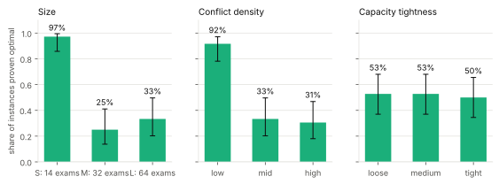
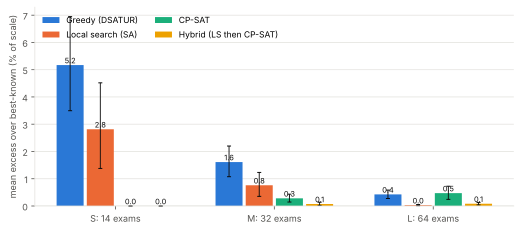
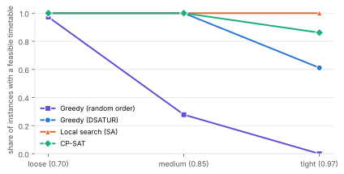
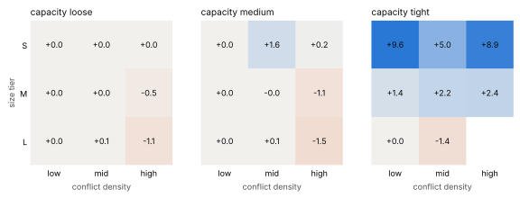

# Constraint-Aware Examination Timetable Optimizer

When does exact solving (OR-Tools CP-SAT) pay off for examination timetabling? A pre-registered comparison of greedy constructions, a tuned local search and CP-SAT on
108 held-out instances, mapped against size, conflict density and capacity tightness.
**Project page:** https://kanishk2705.github.io/Constraint-Aware-Examination-Timetable-Optimizer/

**Flow:** problem -> design -> implementation -> results -> limitations -> next steps (full text with figures on the project page).

## Problem
Place every exam in one slot: no student clash, seats per slot within capacity (hard); few back-to-back exams, at most two exams per student per day, exams spread out (soft, weighted objective in `PROTOCOL.md`).

## Design
Documented generator (`DATA.md`) with a planted feasible timetable; 14 / 32 / 64 exams x density 0.10 / 0.25 / 0.45 x capacity tightness 0.70 / 0.85 / 0.97; 54 tuning and 108 held-out instances from disjoint seeds.
Methods: three greedy constructions, simulated annealing, CP-SAT, and a LS-then-CP-SAT hybrid, all with 20 s and two cores. Six hypotheses and the statistics plan were written in `PROTOCOL.md` before any held-out run.

## Implementation
`src/examtt/`: generator, independent validator (shares no code with the solvers), incremental state, greedy, local search, CP-SAT models, statistics, analysis. `tests/`: validator-can-fail tests, solver-vs-validator agreement, two CP-SAT encodings reaching the same optimum.
1072 stored timetables re-validated; 0 hard violations; 3 claimed-vs-validated mismatches (solver claim above validated cost; Deviation 3).

## Results (held-out; excess over best-known in % of an instance scale, lower is better)
- **H1 proof frontier** S: 97% (35/36; 95% CI 86%-100%) | M: 25% (9/36; 95% CI 14%-41%) | L: 33% (12/36; 95% CI 20%-50%) - not supported: Proof rate: Wilson CI above 0.5 for tier S and below 0.25 for tier L (measured: tier M and L proof rates are both below 50%, but tier L's interval reaches above 0.25)
- **H2a crossover (tier M)** 0.48 [0.05, 0.96] - supported: CP-SAT beats tuned local search in M (D = excess(LS) - excess(CP-SAT) > 0)
- **H2b crossover (tier L)** -0.45 [-0.71, -0.22] - supported: Local search beats CP-SAT in L (D < 0)
- **H3 tightness vs greedy** loose 100% (24/24; 95% CI 86%-100%); tight 0% (0/24; 95% CI 0%-14%); LS tight 100%, CP-SAT tight 79% - not supported: Random-order greedy loses feasibility under tight capacity; LS and CP-SAT stay >= 90% feasible at tight capacity (LS met this; cold CP-SAT did not: it returned no timetable in 5 of 24 tight instances, all tier L, within 20 s)
- **H4 warm start** -0.29 [-0.42, -0.18] - supported: Hybrid beats cold CP-SAT (M+L): mean excess difference < 0
- **H5 one-feature rule** rule - LS: -1.10 [-1.75, -0.56]; rule - CP-SAT: -0.13 [-0.21, -0.05] - supported: CP-SAT if edges <= 505 else LS beats both fixed policies
- **H6 slot minimisation** 73% (79/108; 95% CI 64%-81%) - not supported: DSATUR first-fit already matches CP-SAT's slot count on >= 90% of instances

| Method | Feasible | Mean excess [95% CI] |
|---|---|---|
| Greedy (random order) | 42% (45/108; 95% CI 33%-51%) | 4.97 [2.73, 7.82] |
| Greedy (largest degree) | 69% (75/108; 95% CI 60%-77%) | 1.78 [1.24, 2.43] |
| Greedy (DSATUR) | 87% (94/108; 95% CI 79%-92%) | 2.48 [1.77, 3.29] |
| Local search (SA) | 100% (108/108; 95% CI 97%-100%) | 1.20 [0.67, 1.82] |
| CP-SAT | 95% (103/108; 95% CI 90%-98%) | 0.24 [0.15, 0.34] |
| Hybrid (LS then CP-SAT) | 99% (107/108; 95% CI 95%-100%) | 0.05 [0.03, 0.08] |

## Limitations
Constructed instances only (real benchmarks not reachable, no stated licence); pooled rooms and one-slot exams; CP-SAT's lower bound is 0 until proof, so quality is measured against the best known cost; one 20 s budget and two cores; 4 instances per cell (cells descriptive only); Python local search.

## Next steps
Real Toronto / ITC2007 data once terms are checked; per-room and multi-slot models; compiled local search; a longer budget; stronger CP-SAT bounds.

## Reproduce
`pip install -r requirements.txt && pytest`, then the commands on the project page. Frozen decisions are on the branches `protocol-freeze` and `params-freeze`. Deviations from the protocol are listed in `PROTOCOL.md` section 13.
